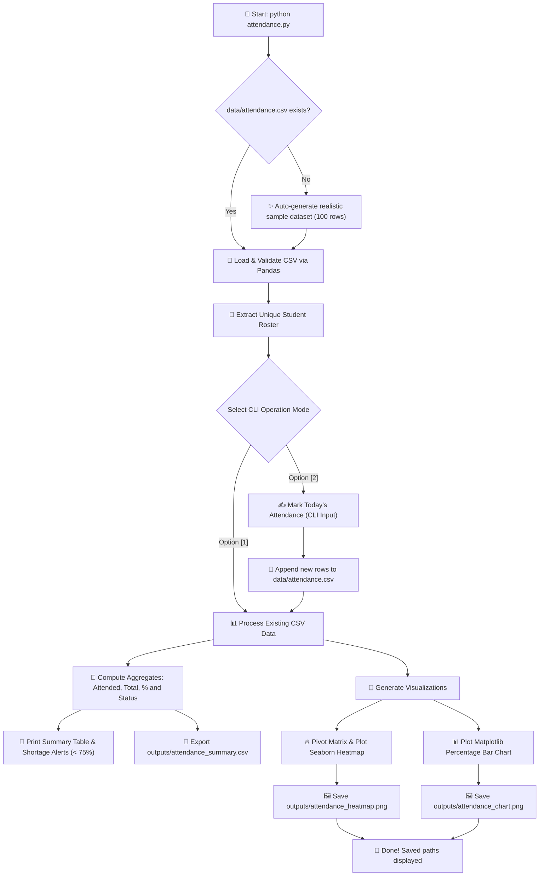

# 📊 Classroom Attendance Heatmap & Chart Analytics

[](https://www.python.org/)
[](https://pandas.pydata.org/)
[](https://seaborn.pydata.org/)
[](https://matplotlib.org/)
[](#)

> **A beginner-friendly, end-to-end Python practical project that transforms daily classroom attendance registers into actionable analytics, instant shortage alerts, and visual heatmaps and bar charts.**

---

## 📑 Table of Contents

1. [🌟 What is This Project?](#-what-is-this-project)
2. [❓ Why is It Needed? (The Problem Statement)](#-why-is-it-needed-the-problem-statement)
3. [💡 What We Did & What We Solved](#-what-we-did--what-we-solved)
4. [🔄 System Architecture & Visual Workflow](#-system-architecture--visual-workflow)
5. [📂 Project Structure](#-project-structure)
6. [📋 Data Model & Dataset Breakdown](#-data-model--dataset-breakdown)
7. [🎨 Visual Outputs Explained](#-visual-outputs-explained)
8. [🚀 Step-by-Step Installation & Usage](#-step-by-step-installation--usage)
9. [🧠 Code Walkthrough & Core Modules](#-code-walkthrough--core-modules)
10. [🎓 Practical / Viva Q&A Guide](#-practical--viva-qa-guide)

---

## 🌟 What is This Project?

The **Classroom Attendance Heatmap & Chart** system is an educational data science application written in Python. It takes raw daily attendance logs, automatically organizes them, evaluates student attendance percentages against a standard academic eligibility requirement (**75.0% threshold**), and produces two intuitive visual charts:

1. **A Daily Attendance Heatmap:** Shows which students attended which lectures across dates at a single glance.
2. **An Attendance Percentage Bar Chart:** Clearly marks who is **Eligible** (green) and who has an **Attendance Shortage** (red), complete with a prominent dashed benchmark line.

Whether you have an existing CSV file or are starting from scratch, the script automatically bootstraps realistic sample data (~100 rows across 10 students and 10 dates) so you can run it immediately without manual setup.

---

## ❓ Why is It Needed? (The Problem Statement)

In most schools, colleges, and university departments:
- **Manual Registers are Cumbersome:** Paper rolls or complex spreadsheets make it difficult to track consistency and detect trends.
- **Hidden Absenteeism Patterns:** A student might miss every Friday lecture or attend in sporadic bursts. Standard numbers alone don't reveal these patterns easily.
- **Late Shortage Detection:** Teachers and administrators often only calculate aggregate percentages at the very end of the semester when it is already too late for students to recover.
- **Risk of Examination Disqualification:** Most educational institutions enforce a strict **75% minimum attendance rule** to appear for examinations. Without early warnings, students face sudden debarment.

### 🎯 How This Project Fixes It
| Problem in Traditional Systems | Solution Provided by This Project |
|---|---|
| Hundreds of scattered presence records | Centralized long-format single CSV dataset (`data/attendance.csv`) |
| Tedious manual percentage calculations | Instant automated computation via `pandas` aggregation |
| Missed patterns & streaks of absences | Color-coded **Heatmap** (`outputs/attendance_heatmap.png`) |
| Surprise exam shortages at term end | Immediate **Terminal Shortage Alerts** & bar chart highlighting `< 75%` |
| Difficulty entering daily records | Built-in interactive **Daily Attendance CLI Menu** |

---

## 💡 What We Did & What We Solved

```
┌────────────────────────────────────────────────────────────────────────┐
│                        WHAT WE SOLVED AT A GLANCE                      │
├────────────────────────────────┬───────────────────────────────────────┤
│ 1. Zero-Setup Data Bootstrapping│ Auto-creates data/attendance.csv (100 │
│                                │ rows) if no CSV exists. Runs instantly│
├────────────────────────────────┼───────────────────────────────────────┤
│ 2. Flexible Data Input         │ Choose existing records OR mark today's│
│                                │ attendance interactively from the CLI. │
├────────────────────────────────┼───────────────────────────────────────┤
│ 3. Automated Eligibility Check │ Evaluates 75% threshold; marks students│
│                                │ as [OK] Eligible or [!] Shortage.      │
├────────────────────────────────┼───────────────────────────────────────┤
│ 4. Clear Visual Dashboards     │ Produces high-res 300 DPI Heatmap and  │
│                                │ Bar Chart ready for academic reporting│
└────────────────────────────────┴───────────────────────────────────────┘
```

---

## 🔄 System Architecture & Visual Workflow

Here is how the data flows from raw input to finished reports and visual charts:



---

## 📂 Project Structure

```text
Krinjal'sProject/
│
├── attendance.py                  # ⭐ Master script containing all tasks & modular functions
├── README.md                      # 📖 Comprehensive project documentation (You are here)
│
├── data/
│   └── attendance.csv             # 🗄️ Master long-format attendance CSV (~100 sample records)
│
└── outputs/
    ├── attendance_summary.csv     # 📑 Aggregated student percentages & eligibility status
    ├── attendance_heatmap.png     # 🖼️ High-resolution Seaborn attendance heatmap
    └── attendance_chart.png       # 🖼️ High-resolution Matplotlib threshold bar chart
```

---

## 📋 Data Model & Dataset Breakdown

### 1. Long-Format Master Data (`data/attendance.csv`)
Instead of wide, unwieldy tables with dozens of date columns, our system adopts a tidy **long-format schema**:

| Column Name | Data Type | Description | Accepted Values |
|---|---|---|---|
| `student_id` | `str` | Unique student roll number | e.g. `S101`, `S102` |
| `student_name` | `str` | Full name of the student | e.g. `Aarav Sharma` |
| `date` | `str` | Lecture session date (`YYYY-MM-DD`) | e.g. `2026-11-02` |
| `status` | `int` | Attendance indicator | `1` = Present, `0` = Absent |

### 2. Sample Dataset Roster & Attendance Distribution
The automatically generated dataset contains **10 students** over **10 lecture dates** ($10 \times 10 = 100\text{ rows}$):

| Roll No. | Student Name | Attended / Total | Percentage | Eligibility Status |
|:---:|:---|:---:|:---:|:---:|
| **S101** | Aarav Sharma | 10 / 10 | 100.00% | 🟢 **[OK] Eligible** |
| **S110** | Tanvi Joshi | 10 / 10 | 100.00% | 🟢 **[OK] Eligible** |
| **S104** | Sneha Reddy | 9 / 10 | 90.00% | 🟢 **[OK] Eligible** |
| **S105** | Vikram Singh | 9 / 10 | 90.00% | 🟢 **[OK] Eligible** |
| **S102** | Ananya Patel | 8 / 10 | 80.00% | 🟢 **[OK] Eligible** |
| **S106** | Priya Nair | 8 / 10 | 80.00% | 🟢 **[OK] Eligible** |
| **S103** | Rohan Gupta | 7 / 10 | 70.00% | 🔴 **[!] SHORTAGE** |
| **S107** | Ishaan Verma | 6 / 10 | 60.00% | 🔴 **[!] SHORTAGE** |
| **S108** | Diya Mukherjee | 5 / 10 | 50.00% | 🔴 **[!] SHORTAGE** |
| **S109** | Kabir Mehta | 4 / 10 | 40.00% | 🔴 **[!] SHORTAGE** |

---

## 🎨 Visual Outputs Explained

### 1. Daily Attendance Heatmap (`outputs/attendance_heatmap.png`)

```
   Dates ──► 2026-11-02  2026-11-03  2026-11-04 ...
Students ▼
Aarav Sharma    [  1  ]     [  1  ]     [  1  ]     ──► (Emerald Green = Present)
Diya Mukherjee  [  1  ]     [  0  ]     [  0  ]     ──► (Coral Red = Absent)
```

- **X-Axis:** Class lecture dates sorted chronologically.
- **Y-Axis:** Student names arranged alphabetically.
- **Color Legend:**
  - 🟩 **Mint / Emerald Green (`#34d399` / `1`):** Student was **Present**.
  - 🟥 **Soft Coral Red (`#f87171` / `0`):** Student was **Absent**.
- **Value in Classroom Management:** Teachers can instantly spot streaks, absenteeism around weekends, or days with unusually low overall class turnout.

---

### 2. Attendance Percentage Bar Chart (`outputs/attendance_chart.png`)

```
  100% ────────────┬─────────────┬─────────────┬─────────────
                   │ 100.0%      │ 90.0%       │
   75% - - - - - - │ - - - - - - │ - - - - - - │ - - - - - - [Red Dashed Threshold]
                   │             │             │ 70.0%
   50%             │             │             │ █ (Shortage: Red)
                   │ █ (Green)   │ █ (Green)   │ █
    0% ────────────┴─────────────┴─────────────┴─────────────
                 Aarav         Sneha         Rohan
```

- **Bar Height:** Student's attendance percentage.
- **Color Coding:**
  - 🟢 **Green Bar:** $\ge 75\%$ (Eligible for exams).
  - 🔴 **Red Bar:** $< 75\%$ (Shortage alert, ineligible).
- **Red Dashed Line (`--`):** Visual reference placed at exactly **75.0%**.
- **Data Labels:** The exact percentage value (e.g. `90.0%`) is displayed right on top of each bar for effortless reading.

---

## 🚀 Step-by-Step Installation & Usage

### Step 1: Open Terminal or PowerShell
Navigate to the project folder:
```powershell
cd c:\Users\shivr\Desktop\Krinjal'sProject
```

### Step 2: Ensure Dependencies Are Installed
Only standard libraries (`os`, `datetime`) plus three standard data science packages are required:
```powershell
pip install pandas matplotlib seaborn
```

### Step 3: Run the Script
Execute the master script:
```powershell
python attendance.py
```

### Step 4: Choose from the Interactive Menu
Upon launch, you will see:
```text
#################################################################
   CLASSROOM ATTENDANCE HEATMAP & CHART SYSTEM
   Practical Project — Attendance Analytics & Visualizations
#################################################################

Please select an operation mode:
  [1] Generate report & charts from existing CSV data
  [2] Mark today's daily attendance (CLI input) & generate updated report
  [3] Exit

Enter choice (1, 2, or 3) [Default: 1]:
```

- **Press `1` (or hit Enter):** Immediately analyzes `data/attendance.csv`, prints the roster, summary table, and shortage alerts, and exports updated charts.
- **Press `2`:** Prompts you to enter attendance for each student in the roster for today's date (or a custom date). Enter `1` for Present, `0` for Absent. The records are appended to the CSV, and updated analytics are generated immediately!
- **Press `3`:** Cleanly exits the program.

---

## 🧠 Code Walkthrough & Core Modules

The script [attendance.py](file:///c:/Users/shivr/Desktop/Krinjal'sProject/attendance.py) is modularized into distinct, single-responsibility functions:

| Function Name | Task Category | Description |
|---|---|---|
| `ensure_sample_data()` | Initialization | Checks for `data/attendance.csv`. If absent, auto-generates 100 realistic rows. |
| `load_and_validate_attendance()` | **Task 1** | Reads CSV via `pandas`, validates required columns, standardizes status to binary `0`/`1`, and sorts records. |
| `print_student_roster()` | **Task 1** | Formats and displays the official roster table with student IDs and names. |
| `mark_daily_attendance()` | **Task 2** | Prompts CLI inputs (`1`/`0`) for each enrolled student and appends new rows. |
| `calculate_attendance_summary()` | **Task 3** | Computes `attended`, `total_classes`, `attendance_pct`, flags shortages, prints tables, and exports `outputs/attendance_summary.csv`. |
| `generate_visualizations()` | **Task 4** | Plots and exports both the Seaborn heatmap and Matplotlib bar chart at 300 DPI. |
| `run_pipeline()` | Pipeline | Coordinates Task 1, Task 3, and Task 4 in seamless succession. |
| `main()` | Application | Main entry point driving the user CLI menu. |

---

## 🎓 Practical / Viva Q&A Guide

**Q1: Why use long-format data (`student_id, student_name, date, status`) instead of wide format?**
> **Answer:** Long-format data is the database and data-science standard (tidy data). It allows adding unlimited lecture dates without adding new columns, makes aggregation in `pandas` simple via `groupby()`, and can be effortlessly pivoted into any shape for heatmaps.

**Q2: How does `pandas.pivot()` work for generating the heatmap?**
> **Answer:** `df.pivot(index='student_name', columns='date', values='status')` reshapes the 1D series of records into a 2D matrix where student names form rows, lecture dates form columns, and cell values contain `1` or `0`.

**Q3: How are the bar colors dynamically assigned in the chart?**
> **Answer:** A Python list comprehension inspects each percentage:
> ```python
> bar_colors = ['#34d399' if pct >= 75.0 else '#f87171' for pct in summary_df['attendance_pct']]
> ```
> This vector of hex codes is passed directly into `plt.bar()`.

**Q4: How does the script handle missing files?**
> **Answer:** Both `data/` and `outputs/` folders use `os.makedirs(..., exist_ok=True)`. If `data/attendance.csv` is missing, `ensure_sample_data()` creates it automatically so the script never crashes on initial launch.

---

## 📄 License & Attribution

Developed as a classroom practical project for **Attendance Analytics & Visual Data Science**.  
Designed to be clean, modular, easily extendable, and beginner-friendly. Happy coding! 🚀
